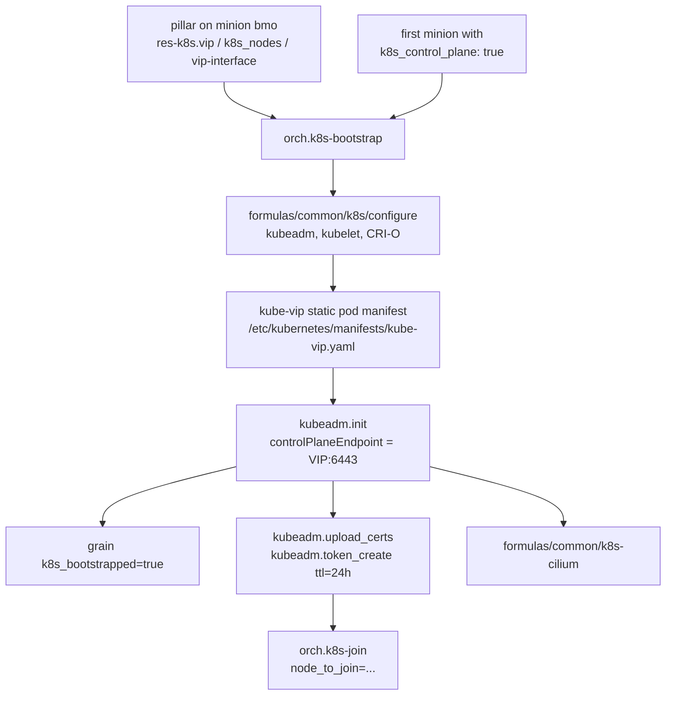

# Kubernetes cluster bootstrap (`orch/k8s-bootstrap.sls`)

How to bring up the **first** HA control-plane node with kube-vip, `kubeadm init`,
and Cilium. Extra nodes are **not** joined here — that is
[`orch/k8s-join.sls`](../orch/k8s-join.sls).

## The short version

1. Put VIP / node list / kube-vip interface in the **`bmo` minion’s**
   `res-k8s` pillar (see [Pillar](#pillar)).
2. Mark the intended first control-plane minion with `k8s_control_plane: true`
   in **that minion’s** pillar.
3. From the Salt master:

   ```bash
   salt-run state.orchestrate orch.k8s-bootstrap
   ```

4. Confirm the VIP answers on `:6443` and `kubectl get nodes` shows the first
   control plane Ready.
5. Join more nodes with `orch.k8s-join`, one minion at a time.



## What this orch does

It targets **one** minion: the first node in `res-k8s.k8s_nodes` whose own
pillar has `k8s_control_plane: true`. If none match, it falls back to
`k8s_nodes[0]` (or `master-rsc-0`).

| Step | State / function | Notes |
|---|---|---|
| Debug | `debug_pillar_data` | Prints VIP, node list, first control node, interface |
| Deps | `salt.state` → `/formulas/common/k8s/configure` | kubeadm/kubelet/kubectl, CRI-O, sysctl, modules |
| Image | `ctr image pull ghcr.io/kube-vip/kube-vip:v0.8.3` | Skipped if the kube-vip manifest already exists |
| Manifest | `ctr run … /kube-vip manifest pod` | Writes `/etc/kubernetes/manifests/kube-vip.yaml` once (`creates:`) |
| Init | `kubeadm.init` | Pod CIDR `10.244.0.0/16`, service CIDR `10.96.0.0/12`, Kubernetes `v1.34.9`, CRI-O socket, endpoint `VIP:6443` |
| Grain | `grains.setval k8s_bootstrapped true` then `saltutil.refresh_grains` | Marks the first node |
| Certs | `kubeadm.upload_certs` | Only if `/etc/kubernetes/admin.conf` exists |
| Token | `kubeadm.token_create` | TTL **24h**, usages `signing` + `authentication` |
| Kubeconfig | copy `kubernetes.kubeconfig` → `/root/.kube/config` | So `kubectl` / Helm / later formulas work as root |
| OIDC | patch kube-apiserver static pod | If `res-k8s:oidc-issuer` is set; Keycloak client `kubernetes` |
| CNI | `/formulas/common/k8s-cilium` | Helm chart, values from `res-k8s:cilium:values` |

It does **not** join additional control-plane or worker nodes. It does **not**
install Multus / NetworkAttachmentDefinitions, cert-manager, ingress, or
OpenStack. Apply `/formulas/common/k8s-multus` later when extra pod NICs are
needed.

## Pillar

### Read from the `bmo` minion

The orch always calls `pillar.show_pillar` with `minion: bmo`. That minion
must exist and compile `res-k8s`. Changing pillar on the Salt master (or on
the k8s node itself) is ignored unless it is also on `bmo`.

```yaml
# compiled for minion id "bmo"
res-k8s:
  vip: 10.160.1.10            # control-plane HA address
  vip-interface: eth0         # kube-vip ARP interface (default eth0)
  oidc-issuer: https://keycloak.rsc.gacyberrange.org/realms/rsc
  k8s_nodes:
    - master-rsc-0
    - master-rsc-1
    - worker-rsc-0
```

| Key | Used for |
|---|---|
| `res-k8s.vip` | kube-vip `--address` and `kubeadm.init` `control_plane_endpoint` (`VIP:6443`) |
| `res-k8s.vip-interface` | kube-vip `--interface`; defaults to `eth0` if omitted |
| `res-k8s.k8s_nodes` | List of minion ids; first control-plane member is picked from this list |
| `res-k8s.oidc-issuer` | Structured AuthenticationConfiguration JWT issuer URL (client-id / audience `kubernetes`, username `preferred_username`, groups `groups`, empty prefixes). Written to `/etc/kubernetes/auth-config.yaml` and `--authentication-config` on kube-apiserver. Kubernetes 1.32+ dropped `--oidc-*`. Omit the key to skip OIDC. |

On the **first control node** (not `bmo`):

```yaml
kubernetes:
  kubeconfig: /etc/kubernetes/admin.conf   # copied to /root/.kube/config after init
```

If omitted, the orch defaults to `/etc/kubernetes/admin.conf`.

`/formulas/common/k8s/install` also installs the `kubernetes` Python package
into the Salt onedir venv via `salt-pip` (`/usr/bin/salt-pip` →
`/opt/saltstack/salt`). That is what `kinetic_k8s` / `k8s` states import.

Cilium runs **on the first control node**, so that node’s pillar also needs
`res-k8s:cilium:values` (see `formulas/common/k8s-cilium/PILLAR-EXAMPLE.md`).

### First control-plane node

For **each** candidate minion id in `k8s_nodes`, the orch loads *that*
minion’s pillar and looks for `k8s_control_plane: true`. The first match
becomes the init target.

```yaml
# compiled for minion id "master-rsc-0"
k8s_control_plane: true
```

`k8s-join.sls` uses a different check (`pillar['bmh'][node]['k8s_control_plane']`)
when deciding control-plane vs worker join. Keep both consistent for the same
host.

## Prerequisites

- Salt master can reach every id in `k8s_nodes`.
- Minion id `bmo` compiles `res-k8s` as above.
- The first control node is up, has a unique hostname matching its minion id,
  and the VIP is **not** already claimed by another cluster.
- `vip-interface` is a real interface on that node (kube-vip uses ARP).
- Outbound pull of `ghcr.io/kube-vip/kube-vip:v0.8.3` works (`ctr`).
- Formula `/formulas/common/k8s` is applied successfully (CRI-O socket at
  `unix:///var/run/crio/crio.sock`).

Confirm pillar **as the orch sees it** before running:

```bash
salt-run pillar.show_pillar minion=bmo
salt-run pillar.show_pillar minion=master-rsc-0
```

Replace `master-rsc-0` with the minion you expect to be first control plane.

## Running it

From the Salt master:

```bash
salt-run state.orchestrate orch.k8s-bootstrap
```

The file is `orch/k8s-bootstrap.sls`; Salt’s orch path is `orch.k8s-bootstrap`.

Watch the first state’s echo line: VIP, node list, first control node, and
interface must match what you intended. If `First Control Node` is wrong,
stop and fix pillar — do not continue.

### After a successful run

On the first control node:

```bash
sudo kubectl get nodes
sudo kubectl get pods -A
curl -k https://<VIP>:6443
```

`kubectl` should pick up `/root/.kube/config` (copied from
`pillar['kubernetes']['kubeconfig']`, normally `admin.conf`). You should see
one control-plane node, Cilium pods in `kube-system`, and kube-vip running as a
static pod. Grain:

```bash
salt '<first-control-node>' grains.item k8s_bootstrapped
```

should be `true`.

Python client in the Salt venv:

```bash
/usr/bin/salt-pip show kubernetes
```

Join tokens last **24 hours**. Create a fresh one (or run join soon) — see
[Joining more nodes](#joining-more-nodes).

## Idempotency / re-run

Safe to re-run in most cases:

- kube-vip image pull and manifest generation are skipped if
  `/etc/kubernetes/manifests/kube-vip.yaml` already exists.
- `kubeadm.init` is skipped if `https://VIP:6443` already answers
  (`unless: curl -k --connect-timeout 5 …`).
- `upload_certs` / `token_create` only run when `admin.conf` exists; init is
  watched/required so they do not run on a half-installed node.

Not a full reset. If init failed **after** writing files but **before** the
API came up on the VIP, `unless` may still try `kubeadm.init` again, or you
may need a manual `kubeadm reset` on that node. Do not reset a healthy
cluster just to re-run the orch.

Changing kube-vip version or the VIP itself: delete
`/etc/kubernetes/manifests/kube-vip.yaml` on the first node (so `creates:`
fires again), then re-run. Changing Kubernetes version requires a real
upgrade path, not this orch.

## Joining more nodes

Use [`orch/k8s-join.sls`](../orch/k8s-join.sls) **after** bootstrap. Pass the
bootstrap node (the one that has `admin.conf`) and the minion to join:

```bash
salt-run state.orchestrate orch.k8s-join \
  pillar='{"bootstrap_node": "master-rsc-0", "node_to_join": "master-rsc-1"}'
```

- `bootstrap_node` is used to read `res-k8s` (VIP / interface) and to run
  `kubeadm token create --print-join-command`.
- Control-plane joins get a kube-vip manifest and `--control-plane` in the
  printed command path when `bmh.<node>.k8s_control_plane` is defined on the
  joining minion.
- Already-registered nodes (`kubectl get nodes` name match) are skipped.

Join tokens from bootstrap expire in 24h; `k8s-join` creates a new token as
part of the run.

## Troubleshooting

- **`First Control Node` is unexpected** — orch compiled `k8s_control_plane`
  from each id in `k8s_nodes`. Confirm with
  `salt-run pillar.show_pillar minion=<id>`. Empty flag falls back to
  `k8s_nodes[0]`.
- **Jinja error / `res-k8s` missing** — pillar was compiled for minion **`bmo`**,
  not for the k8s node. `salt-run pillar.show_pillar minion=bmo`.
- **`kubeadm.init` skipped but cluster is broken** — `curl` to `VIP:6443`
  succeeded (anything listening). Check kube-vip and kube-apiserver pods; the
  orch will not re-init.
- **`kubeadm.init` ran twice / crashed** — inspect
  `/var/log/pods` and `journalctl -u kubelet` on the first node. You may need
  `kubeadm reset` before a clean retry.
- **kube-vip image pull failed** — `ctr` (containerd) is used here even though
  kubeadm talks to **CRI-O**. Both runtimes must be present on the node
  (`formulas/common/k8s/configure` starts containerd and CRI-O).
- **API never on VIP** — wrong `vip-interface`, VIP already used, or kube-vip
  manifest missing. File:
  `/etc/kubernetes/manifests/kube-vip.yaml`.
- **Cilium fail** — the formula reads **the first control node’s** pillar
  (`res-k8s:cilium:values`). Helm/`kubectl` need `/root/.kube/config` on that
  node; they run after init and the kubeconfig copy.
- **Join fails with expired token** — bootstrap’s `token_create` is 24h.
  Re-run `orch.k8s-join` (it mints a new token) rather than reusing the
  bootstrap token by hand.

Last updated: October 2026
