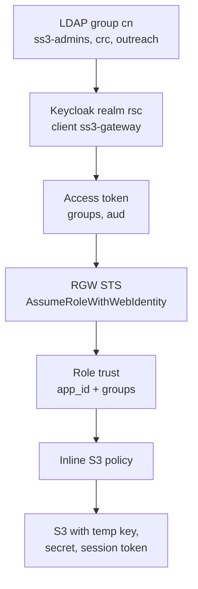

# LDAP, Keycloak, and RGW S3

How a person in an LDAP group gets an S3 session on the Ceph object store.
LDAP owns membership. Keycloak authenticates and puts that membership in the
access token. RGW authorizes the session from a role whose trust policy names
the same group. Later S3 calls do not see the token, only the temporary
credentials from `AssumeRoleWithWebIdentity`.

This is the ss3 store (`ss3-gateway` on `https://ss3.gacyberrange.org`). The
Salt side is `formulas/common/k8s-rook/object-store.sls`. Module details are
in [`kinetic-rook.md`](kinetic-rook.md). Keycloak LDAP federation itself is
the same pattern as [`ldap-keycloak-keystone.md`](ldap-keycloak-keystone.md).

## The short version

- **LDAP** is the source of truth for who is in `ss3-admins`, `crc`, and
  `outreach`. RGW role names and trust conditions follow those `cn`s. Do not
  rename LDAP to match an older RGW role.
- **Keycloak** (realm `rsc`) federates that LDAP tree read-only. Client
  `ss3-gateway` is a public device-grant client. Its access token must carry
  the bare group name (`ss3-admins`, not `/ss3-admins`) and audience
  `ss3-gateway`.
- **RGW** does not trust Keycloak realm roles. It trusts the OIDC provider
  keyed by the issuer URL, then allows assume-role only when `app_id` and
  `groups` match. The role's inline policy is what can list or write a bucket.



Authentication stops at the access token. Authorization is two checks:

| Check | When | What must match |
|---|---|---|
| Role trust | `AssumeRoleWithWebIdentity` only | issuer, thumbprint, `app_id` = `ss3-gateway`, `groups` contains the LDAP `cn` |
| Inline policy | every later S3 call | the role's actions on that bucket ARN |

A token with realm role `ss3-admins` and an empty `groups` claim fails the
trust check. RGW does not read `realm_access.roles`.

## What each piece is called

| Thing | Name |
|---|---|
| Object store / RGW realm, zonegroup, zone | `ss3-gateway` |
| Public endpoint | `https://ss3.gacyberrange.org` |
| In-cluster RGW | `http://rook-ceph-rgw-ss3-gateway.rook-ceph.svc:80` |
| Issuer | `https://keycloak.rsc.gacyberrange.org/realms/rsc` (no trailing slash) |
| OIDC provider | `arn:aws:iam:::oidc-provider/keycloak.rsc.gacyberrange.org/realms/rsc` |
| Keycloak client | `ss3-gateway` (public, device grant on, service accounts off) |
| IAM signing user | `rgw-iam-admin` in realm `ss3-gateway`, cap `oidc-provider=*` |
| Bucket owner | `ss3-gateway-owner` (not handed to users) |

Roles in that realm:

| LDAP group | RGW role | Inline policy |
|---|---|---|
| `ss3-admins` | `ss3-admins-role` | `s3:*` on `crc` and `outreach` |
| `crc` | `crc-role` | `GetObject`, `ListBucket`, `GetBucketLocation` on `crc` |
| `outreach` | `outreach-role` | `GetObject`, `PutObject`, `DeleteObject`, `ListBucket`, `GetBucketLocation` on `outreach` |

`aws s3 ls` with no bucket is `s3:ListAllMyBuckets` on `arn:aws:s3:::*`. None
of these policies grant it. List a bucket: `aws s3 ls s3://crc/`.

## Object store pillar

`formulas/common/k8s-rook/object-store.sls` reads
`pillar['res-k8s']['rook']['object_store']`. Quote `*`. An unquoted star is a
YAML alias. Use `group`, not `groups`.

```yaml
res-k8s:
  rook:
    namespace: rook-ceph
    object_store:
      name: ss3-gateway
      gateway_instances: 2
      erasure_coded:
        data_chunks: 2
        coding_chunks: 1
      hosts:
        - ss3.gacyberrange.org
      gateway_name: traefik-gateway
      gateway_namespace: ingress
      gateway_section: websecure
      sts_key: "<same 16+ char key on every RGW>"  # ceph-authtool --gen-print-key
      keycloak:
        realm: rsc
        client_id: ss3-gateway
        client_name: RGW ss3-gateway
        public_client: true
        service_accounts_enabled: false
        redirect_uris:
          - https://ss3.gacyberrange.org/*
      oidc:
        issuer_url: https://keycloak.rsc.gacyberrange.org/realms/rsc
        client_id: ss3-gateway
        audience_claim: app_id
        group_prefix: ""          # claim is the bare LDAP cn
        iam_user: rgw-iam-admin
        realm: ss3-gateway
        zonegroup: ss3-gateway
        zone: ss3-gateway
        group_roles:
          - group: ss3-admins
            role: ss3-admins-role
            buckets: ['*']
          - group: crc
            role: crc-role
            buckets: [crc]
            actions: [s3:GetObject, s3:ListBucket]
          - group: outreach
            role: outreach-role
            buckets: [outreach]
            actions: [s3:GetObject, s3:PutObject, s3:DeleteObject, s3:ListBucket]
```

Leave out `oidc.role` and `oidc.buckets` unless that extra role should have
an inline policy. A trust-only role assumes cleanly and then 403s every
bucket. The formula creates it only when `oidc.buckets` is set.

`group_prefix` defaults to empty. Set it to `/` only if a group mapper still
emits the full path. A leftover `group: ss3-admin` or `group_prefix: /` puts
the old condition back on the next state run.

Do not set a client secret in pillar for this public client. Device grant
does not use one. If a secret was exported, rotate it in Keycloak and delete
the export.

The formula does not create the LDAP groups. Those still come from
`pillar['ldap']['groups']` via `formulas/common/ldapadmin/prov.sls`, same as
the Keystone path. A group used here only needs a `cn` that matches
`oidc.group_roles[].group`.

## Add a bucket, group, or member

Apply `formulas/common/k8s-rook/object-store` on the minion that has this
pillar. It is also included by `formulas/common/k8s-rook/cluster`. Sync the
execution module first if `_modules/kinetic-rook.py` changed, or the minion
keeps the old role logic.

```bash
salt '<minion>' saltutil.sync_modules
salt '<minion>' state.apply /formulas/common/k8s-rook/object-store
```

**New bucket for an existing group.** Add the name to that entry's
`buckets` list and re-apply. The state creates the bucket if it is missing
(owner `ss3-gateway-owner`) and rewrites that role's inline policy.

`buckets: ['*']` does not create a bucket. `*` is skipped on purpose. A new
bucket has to be named on some `group_roles` entry (or in `oidc.buckets`)
or nothing creates it. If the admin entry lists bucket names instead of
`*`, add the new name there too, or `ss3-admins-role` cannot see it.

```yaml
- group: crc
  role: crc-role
  buckets: [crc, crc-archive]
  actions: [s3:GetObject, s3:ListBucket]
```

The same name on two entries is one bucket and two policies. Members who
already assumed the role keep the old policy until that session ends.
Assume the role again after the state run.

**New group.** LDAP first, then the object-store pillar. The role name
defaults to `<group>-role`. Set `claim` only when the token string is not
the group `cn`. Set `role` only to keep an existing RGW role name.

```yaml
ldap:
  groups:
    - cn: training
      members:
        - jsmith

# object_store.oidc.group_roles
- group: training
  buckets: [training]
  actions: [s3:GetObject, s3:ListBucket]
```

That creates bucket `training`, role `training-role`
(`arn:aws:iam:::role/training-role`), trust condition `groups` = `training`,
and an inline policy. Clients must assume that ARN. The Keycloak group
mapper still has to emit `training` with no leading slash. Log in again and
confirm the new access token's `groups` claim before debugging RGW. A realm
role of the same name is not the claim RGW checks.

**New member of an existing group.** Add the uid under that LDAP group's
`members` and apply the LDAP state. Do not add an RGW user. The next login
picks up the group. An already issued token will not.

**Widen or tighten a group.** Change `actions` and re-apply. Omit `actions`
for `s3:*` on that entry's buckets. A tight list must include
`s3:ListBucket`. The module adds `s3:GetBucketLocation`.

Removing a `group_roles` entry does not delete the RGW role, its inline
policy, or the bucket. Salt only stops managing them. Delete a role in the
store realm if it should actually go away:

```bash
radosgw-admin role delete --role-name=training-role \
  --rgw-realm=ss3-gateway --rgw-zonegroup=ss3-gateway --rgw-zone=ss3-gateway
```

Do not delete the bucket from this flow. That is data, not an auth change.

## What the state creates

`object-store.sls` applies, in order:

1. `rook.ceph_object_store_present` with `enable_sts`, `rgw_sts_key`, and
   APIs `s3`, `sts`, `iam`. TLS terminates on the Gateway; the RGW Service
   stays on port 80.
2. `rook.oidc_provider_present`. This is `CreateOpenIDConnectProvider`, not
   `radosgw-admin oidc` (that CLI is newer than this Ceph). Thumbprints are
   SHA1 of the JWKS `x5c` certs. Omit `thumbprints` to discover them.
3. `rook.rgw_bucket_present` for every bucket named under `group_roles`
   (and `oidc.buckets`). `*` is skipped. Missing buckets are created with a
   signed S3 PUT. `radosgw-admin bucket create` is gone.
4. One `rook.rgw_role_present` plus `rook.rgw_role_policy_present` per
   `group_roles` entry. The policy state adds `s3:GetBucketLocation` when the
   action list is not `s3:*`. Clients send that before `ListBucket`.
5. An HTTPRoute from `hosts` to `rook-ceph-rgw-<store>`.
6. `keycloak.client_present` and `keycloak.protocol_mapper_present`
   (`oidc-audience-mapper`, client id on the access token, not the ID token).

`rgw-iam-admin` is created in the store realm by `oidc_provider_present`.
Do not use `CephObjectStoreUser` for it: Rook's controller calls Admin Ops
and fails with `NoSuchBucket` on this store. A user of the same name in zone
`default` will not authenticate. The toolbox defaults to that zone, so every
`radosgw-admin` call needs `--rgw-realm=ss3-gateway --rgw-zonegroup=ss3-gateway --rgw-zone=ss3-gateway`.

Tentacle only dispatches IAM when `Action` is in the POST body. A
query-string `Action` returns 405 `op=unknown`.

## Keycloak token

The group mapper must have full path off, so the claim is `ss3-admins` and
not `/ss3-admins`. The audience mapper must add `ss3-gateway` to the access
token. Keycloak otherwise sets `aud` to `account`, and RGW copies `aud` into
`<issuer>:app_id`.

A usable access token has:

- `iss` exactly `https://keycloak.rsc.gacyberrange.org/realms/rsc`
- `aud` including `ss3-gateway` (the trust condition key is `app_id`, not
  `aud` or `azp`)
- `groups` containing the LDAP `cn`, with no leading slash

Tokens issued before the mapper change keep the old claims. Log in again.

## Client flow

1. Device grant (or another grant) against the Keycloak client. No client
   secret.
2. `AssumeRoleWithWebIdentity` against `https://ss3.gacyberrange.org` with
   `RoleArn=arn:aws:iam:::role/ss3-admins-role` (or `crc-role` /
   `outreach-role`), `RoleSessionName`, and `WebIdentityToken`.
3. S3 calls use the three returned values: access key, secret, and session
   token. The Keycloak token and `rgw-iam-admin` keys are not an S3 session.

s3cmd needs the session token as `access_token`, SigV4, and path-style
hosting or the signature will not match this single hostname:

```bash
s3cmd --access_key="$AWS_ACCESS_KEY_ID" \
  --secret_key="$AWS_SECRET_ACCESS_KEY" \
  --access_token="$AWS_SESSION_TOKEN" \
  --host=ss3.gacyberrange.org \
  --host-bucket=ss3.gacyberrange.org \
  ls s3://crc/
```

AWS CLI:

```bash
aws s3 ls s3://crc/ --endpoint-url https://ss3.gacyberrange.org
```

`AWS_SESSION_TOKEN` has to be set or the request is not the assumed role.

## Failures we already hit

RGW access logs show the OIDC shadow user (`$oidc$<sub>`), not the role name.
Check `AssumedRoleUser` in the STS response. User `-` means the request
arrived unsigned.

| Log / client error | Cause |
|---|---|
| `Role not found: name:...` | `RoleArn` does not exist in realm `ss3-gateway`. A default-zone role is invisible to this RGW. |
| `evaluating policy for op: 144 returned deny/pass` | Assume-role trust failed. Op 144 is `sts:AssumeRoleWithWebIdentity`. Token `groups` or `app_id` does not match. Often a stale token, a leading `/`, or `aud=account`. |
| HTTP 403, user `-`, `GET /bucket/?location` | s3cmd location probe with no credentials, or no session token. The bucket can still exist. |
| Authenticated `$oidc$...` 403 on `list_bucket` | Wrong role, or a trust-only role with no inline policy. |
| `GetBucketLocation` 403 after a good assume | Tight policy omitted it. The module adds it; sync modules before re-applying or the old module strips it. |
| `aws s3 ls` with no bucket 403 | `s3:ListAllMyBuckets` is not granted. Name the bucket. |

Do not debug this with the default-zone `oidc-admin` key, and do not give
users the bucket-owner keys.
